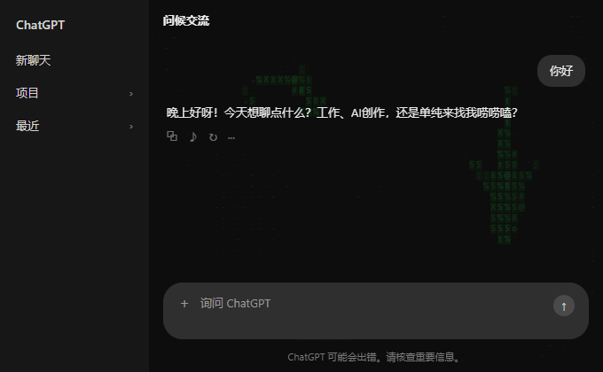
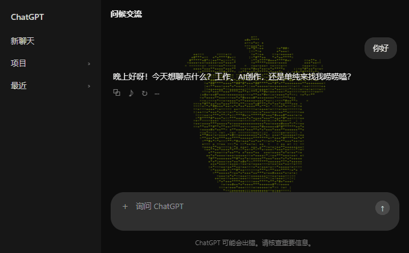
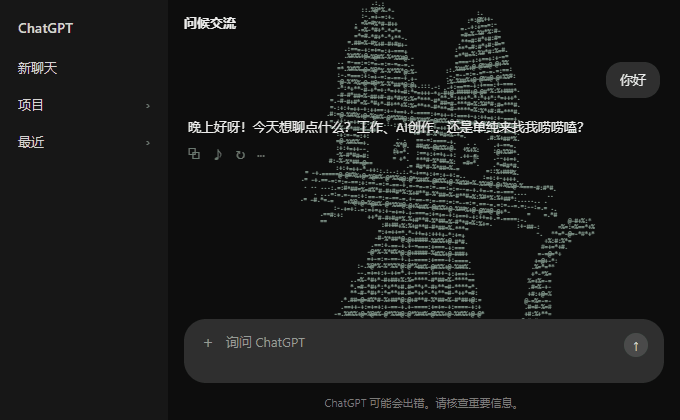
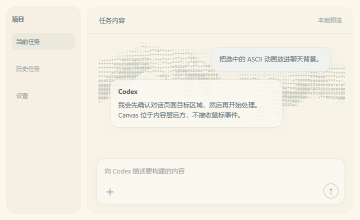
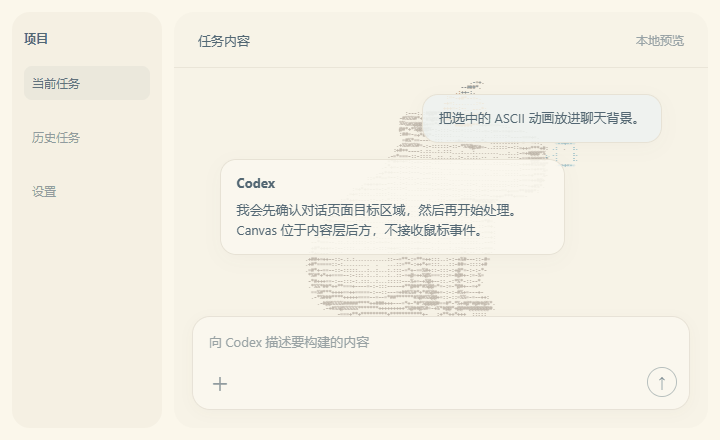

# ASCII Shark Chat Background

[English](#english) | [简体中文](#简体中文)



| 心脏 · 深色主题 | 猫 · 深色主题 |
| :---: | :---: |
|  |  |
| **双手 · 浅色主题** | **卡皮巴拉 · 浅色主题** |
|  |  |

*五种可选聊天背景动画；演示中对话内容与输入框始终位于动画层上方。 / Five selectable chat background animations; the conversation and composer always stay above the animation layer.*

<a name="简体中文"></a>
## 简体中文

把 ASCII 鲨鱼动画作为背景，显示在 **ChatGPT / Codex 桌面端可识别的对话主内容区** 后方。项目使用本地回环 CDP 将动画可撤销地注入页面，不修改官方安装包、`app.asar` 或签名文件。

动画灵感与核心 OceanEngine、World 和角色绘制逻辑来自 [stackedlol/ascii-sharks](https://github.com/stackedlol/ascii-sharks)。本项目保留了上游 MIT 许可文本，详见 [`src/animation/LICENSE.ascii-sharks`](src/animation/LICENSE.ascii-sharks)。本项目自身代码采用 MIT 许可。

### 功能

- Canvas 鲨鱼动画，初始 3 条；支持 1–12 条、8 种上游鲨鱼外形（混合或指定品种：普通鲨、锤头鲨、大锤头鲨、斑马鲨、虎鲨、灰鲭鲨、长尾鲨、护士鲨）、透明度、速度、颜色、暂停、总开关和恢复默认。
- 五种可切换背景动画，在设置页选择，切换时互不叠加，新配置默认为鲨鱼：
  - **鲨鱼**：1–12 条、8 个品种可混选，透明度、速度、颜色可调。
  - **双手**：点阵双手托住固定的网页窗口，手臂与指尖随呼吸分层微动；独立的透明度、颜色、速度、比例、字符字号。
  - **猫**：坐在输入框上沿，头颈与胡须一起活动，双耳各自转动，会眨眼；独立颜色和整体大小。
  - **卡皮巴拉**：头与橘子缓缓下垂再回正，鼻尖泡泡随呼吸鼓起缩回；独立颜色和整体大小。
  - **心脏**：按参考图轮廓逐字绘制的 ASCII 心脏，心跳后沿轮廓扩散五层浅色波纹；独立颜色和整体大小（默认 80%）。
  - 猫、卡皮巴拉、心脏共用透明度和动作速度设置。
- 可视化设置与独立动画预览：`http://127.0.0.1:4181/`。
- 在可识别的 ChatGPT、Codex 和 Work 对话模式中注入到主内容区；侧边栏和导航不覆盖，动画层不接收鼠标或键盘事件。
- 页面重载及聊天切换时由 watcher 重新定位；关闭 watcher 可清除注入。
- 本地 CDP 和设置服务仅监听 `127.0.0.1`。
- 附带桌面快捷方式图标；图标权利说明见 [`assets/ASSET-NOTICE.md`](assets/ASSET-NOTICE.md)。

### Windows 安装与启动

要求 Windows 10/11、Microsoft Store 版 Codex 桌面客户端、Node.js 22 或更新版本。

```powershell
npm ci
npm run setup:windows
```

安装脚本会在桌面和开始菜单创建 **Codex with ASCII Sharks** 与 **ASCII Shark Settings** 快捷方式，不会覆盖官方 Codex 快捷方式。之后使用带鲨鱼的快捷方式打开 Codex Work 页面；设置快捷方式可调参数。若系统弹出安全提示，请先检查项目来源和脚本内容，再由你自行决定是否运行。

也可从项目目录启动：

```powershell
npm run dev       # 演示/设置页
npm run cdp:start # 启动或复用带本机 CDP 的 Codex
npm run inject    # 启动可撤销注入 watcher
```

首次启用 CDP 时，如果 Codex 已在普通模式运行，启动流程可能请求正常重启客户端。请先保存未发送的输入。CDP 端口 `9335` 仅绑定回环地址；不要自行将其改为 `0.0.0.0`。

### 让 Codex Agent 自动安装并验证（复制指令）

> 适用于有本机终端和文件访问能力的 Codex Agent。Windows 可安装桌面快捷方式；Mac 暂无注入适配，Agent 应如实报告。

```text
请在这台电脑安装并验证 ASCII Shark Chat Background：
https://github.com/Eyort/Codex-ASCII-Shark

- 先识别操作系统，以及 Codex/ChatGPT 桌面客户端的准确名称和版本；不要假设 Chat、Work、Codex 页面 DOM 相同。
- Windows 使用 %USERPROFILE%\source\Codex-ASCII-Shark，macOS 使用 ~/Projects/Codex-ASCII-Shark。若目录已存在，先检查 Git 状态并保留本地改动；不要覆盖或清理用户文件。只从上面的仓库克隆。
- 先读 README、许可、配置示例和准备执行的脚本。不要索取密码、Cookie、令牌；不要改官方 app 包、app.asar 或签名文件；CDP 仅绑定 127.0.0.1。
- 检查 Node.js 22+。若缺失，说明后通过官方来源安装，不运行不明安装器。
- 在项目目录运行 npm ci、npm run typecheck、npm test、npm run build；失败就诊断、修复项目内问题并重跑，不得谎报通过。
- 当前注入目标是 Windows 10/11 + Microsoft Store ChatGPT/Codex 桌面客户端。测试通过后运行 npm run setup:windows，创建本项目快捷方式但不替换官方快捷方式；检查设置页和动画演示。
- 若启用 CDP 需要关闭/重启正在运行的客户端，先检查未发送内容；绝不强杀。需要重启时先停下征求我确认。运行后在可识别的 ChatGPT、Codex、Work 对话模式检查动画位于主内容区后方，输入、滚动、文字选择和快捷键正常；不能验证就明确说明。
- 在 macOS 不运行 Windows PowerShell 脚本，不声称注入可用；只跑适用的源码检查并说明 Mac 启动适配尚未实现。
- 最后列出安装路径、执行命令及结果、快捷方式位置、停止/恢复方法和未完成的实机验证。
```
### 配置示例

复制 `.codex-shark.config.example.json` 为 `.codex-shark.config.json`，或使用可视化设置页面。用户配置不会提交到 Git。

```json
{
  "enabled": true,
  "paused": false,
  "animation": "shark",
  "count": 3,
  "opacity": 0.32,
  "speed": 0.55,
  "color": "#718a99",
  "kind": "mixed",
  "handsOpacity": 0.28,
  "handsSpeed": 1,
  "handsColor": "#687b72",
  "handsSize": 1,
  "handsGlyphSize": 1.2,
  "sceneOpacity": 0.58,
  "sceneSpeed": 1,
  "catColor": "#8ca99a",
  "catSize": 1,
  "capybaraColor": "#a79c91",
  "capybaraSize": 1,
  "heartColor": "#b97988",
  "heartSize": 0.8,
  "port": 9335,
  "pollIntervalMs": 1200
}
```

### 关闭与恢复

- 执行 `npm run stop:background`：停止 watcher 并清理页面注入。
- 执行 `npm run cdp:stop`：请求正常关闭带 CDP 的 Codex 会话。
- 执行 `npm run config:reset`：恢复默认动画配置。
- 执行 `powershell -NoProfile -ExecutionPolicy RemoteSigned -File scripts/install-windows-shortcuts.ps1 -Remove`：只移除此项目创建的快捷方式。
- 日志位于 `%LOCALAPPDATA%\ASCIISharkCodex\`。

### 支持范围与限制

| 平台/页面 | 状态 |
|---|---|
| Windows 10/11 的 Microsoft Store ChatGPT/Codex 客户端，对话主页面 | 当前支持；本机已验证 ChatGPT 对话模式，其他布局按可识别的主区结构挂载 |
| 分离窗口、工具页或没有明确模式与对话输入框的页面 | 安全跳过，不自动注入 |
| macOS Codex | 尚未实现启动适配，也未在 Mac 上验证 |

Codex 更新可能更改页面 DOM 或启动方式，届时需要重新验证定位逻辑。当前验证不覆盖所有窗口尺寸、DPI、多窗口和客户端版本。详细交接信息见 [`docs/PLATFORM-STATUS.md`](docs/PLATFORM-STATUS.md)。注入器无法识别页面时会跳过，不读取聊天正文、Cookie 或访问令牌。

### 开发与验收

```powershell
npm run typecheck
npm test
npm run build
npm run dev
```

维护者在 Windows 设备已检查设置页、动画预览、配置边界测试、构建和一次 Work 页面挂载/重载清理流程。不同 Codex 版本和机器的实际页面行为仍需自行验收。

---

<a name="english"></a>
## English

Add a subtle ASCII shark animation behind the main content area of recognized **ChatGPT and Codex desktop conversation modes**. The project injects a layer through local loopback CDP and can remove it again. It does not modify the official app package, `app.asar`, or signature files.

The animation is inspired by and reuses the core OceanEngine, World, and character-drawing logic from [stackedlol/ascii-sharks](https://github.com/stackedlol/ascii-sharks). Its MIT notice is retained at [`src/animation/LICENSE.ascii-sharks`](src/animation/LICENSE.ascii-sharks). This project's own code is MIT licensed.

### Features

- Canvas animation with 3 sharks by default; configure 1–12 sharks, opacity, speed, color, pause, enable/disable, and reset.
- Choose a mixed group of eight upstream shark shapes or select classic, hammerhead, great hammerhead, zebra, tiger, mako, thresher, or nurse shark.
- Five selectable background animations, chosen in the settings page. Switching never stacks layers, and shark is the default for new configurations:
  - **Shark**: 1–12 sharks across eight selectable or mixed species, with opacity, speed, and color controls.
  - **Hands**: dotted hands holding a fixed web window, arms and fingertips drifting in layered breathing motion; independent opacity, color, speed, scale, and glyph-size settings.
  - **Cat**: sits on the composer's top edge; head, neck, and whiskers move together, ears rotate independently, and it blinks; independent color and overall size.
  - **Capybara**: head and orange dip slowly and spring back while the nose bubble swells and shrinks; independent color and overall size.
  - **Heart**: an anatomical heart drawn glyph by glyph from a reference outline, with five soft ripples expanding after each beat; independent color and overall size (80% by default).
  - The cat, capybara, and heart scenes share opacity and speed settings.
- Visual settings and a standalone animation preview at `http://127.0.0.1:4181/`.
- Injection supports recognized ChatGPT, Codex, and Work conversation modes. It stays inside the main conversation area and never receives pointer or keyboard input.
- A local watcher reattaches after page reloads and chat switches; stopping it removes the injected layer.
- CDP and the settings server bind to `127.0.0.1` only.
- Includes a desktop shortcut icon. See [`assets/ASSET-NOTICE.md`](assets/ASSET-NOTICE.md) for its separate rights notice.

### Windows setup

Requires Windows 10/11, the Microsoft Store Codex desktop client, and Node.js 22 or later.

```powershell
npm ci
npm run setup:windows
```

The setup script creates **Codex with ASCII Sharks** and **ASCII Shark Settings** shortcuts on the Desktop and in the Start Menu. It does not replace the official Codex shortcut. Use the project shortcut to launch Codex with the local animation watcher; use the settings shortcut to adjust the animation. Review the source and origin of scripts before running them if Windows displays a security prompt.

You can also start from the project folder:

```powershell
npm run dev       # settings and preview
npm run cdp:start # launch/reuse Codex with local CDP
npm run inject    # start the reversible injection watcher
```

If Codex is already running without CDP, first-time setup may request a normal app restart. Save any unsent input first. CDP port `9335` binds to loopback only; do not change it to `0.0.0.0`.

### Let a Codex agent install and verify (copy this prompt)

> For a Codex agent with local terminal and file access. Windows can install desktop shortcuts. macOS has no injection adapter yet; the agent must report that accurately.

```text
Install and verify ASCII Shark Chat Background on this computer:
https://github.com/Eyort/Codex-ASCII-Shark

- First identify the OS and the exact Codex/ChatGPT desktop app name and version. Do not assume Chat, Work, and Codex pages share a DOM.
- Use %USERPROFILE%\source\Codex-ASCII-Shark on Windows or ~/Projects/Codex-ASCII-Shark on macOS. If it already exists, inspect Git status and preserve local changes; never overwrite or clean user files. Clone only from the URL above.
- Read the README, licenses, config example, and scripts before running them. Never ask for passwords, cookies, or tokens. Do not modify the official app package, app.asar, or signatures. Bind CDP to 127.0.0.1 only.
- Check for Node.js 22+. If missing, explain and use an official source; never run an unknown installer.
- In the project folder run npm ci, npm run typecheck, npm test, and npm run build. Diagnose and fix project-scoped failures, then rerun; never claim a failed step passed.
- Injection currently supports Windows 10/11 with the Microsoft Store ChatGPT/Codex desktop client. After checks pass, run npm run setup:windows without replacing the official shortcut; check the settings page and animation demo.
- If enabling CDP requires closing/restarting the client, check for unsent content first and never force-kill it. Stop and ask me before restarting. Verify the effect in recognized ChatGPT, Codex, and Work conversation modes, and check typing, scrolling, text selection, and shortcuts; say clearly if a check cannot be made.
- On macOS, do not run Windows PowerShell scripts or claim injection works. Run applicable source checks and report that the Mac launcher adapter is not implemented.
- Finish with the install path, commands and results, shortcut locations, stop/reset steps, and any live checks still outstanding.
```
### Example configuration

Copy `.codex-shark.config.example.json` to `.codex-shark.config.json`, or use the visual settings page. Personal configuration is excluded from Git.

```json
{
  "enabled": true,
  "paused": false,
  "animation": "shark",
  "count": 3,
  "opacity": 0.32,
  "speed": 0.55,
  "color": "#718a99",
  "kind": "mixed",
  "handsOpacity": 0.28,
  "handsSpeed": 1,
  "handsColor": "#687b72",
  "handsSize": 1,
  "handsGlyphSize": 1.2,
  "sceneOpacity": 0.58,
  "sceneSpeed": 1,
  "catColor": "#8ca99a",
  "catSize": 1,
  "capybaraColor": "#a79c91",
  "capybaraSize": 1,
  "heartColor": "#b97988",
  "heartSize": 0.8,
  "port": 9335,
  "pollIntervalMs": 1200
}
```

### Stop and restore

- `npm run stop:background` stops the watcher and removes the injected layer.
- `npm run cdp:stop` requests a normal close of the Codex CDP session.
- `npm run config:reset` restores default animation settings.
- Run `powershell -NoProfile -ExecutionPolicy RemoteSigned -File scripts/install-windows-shortcuts.ps1 -Remove` to remove only shortcuts created by this project.
- Logs are stored in `%LOCALAPPDATA%\ASCIISharkCodex\`.

### Compatibility and limitations

| Platform/page | Status |
|---|---|
| Windows 10/11 Microsoft Store ChatGPT/Codex desktop, conversation content | Supported when the app mode and main conversation area are recognized; ChatGPT conversation mode verified on this machine |
| Detached windows, utility pages, or pages without a recognized mode/composer | Safely skipped; injection is not attempted |
| Codex for macOS | Launcher adapter is not implemented and Mac has not been tested |

Codex updates may change the page DOM or startup behavior and require selector revalidation. Current verification does not cover every window size, DPI setting, multi-window setup, or app version. See [`docs/PLATFORM-STATUS.md`](docs/PLATFORM-STATUS.md) for the handoff. If a page cannot be identified, the injector skips it. It does not read chat text, cookies, or access tokens.

### Development and verification

```powershell
npm run typecheck
npm test
npm run build
npm run dev
```

The maintainer has checked the settings page, animation preview, configuration-boundary tests, build, and one Work-page attach/reload/cleanup flow on Windows. Actual behavior still needs verification across Codex versions and machines.
